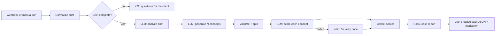

# brief-to-creative

An n8n workflow that takes a client ad brief and turns it into a ranked pack of production-ready AI video ad concepts: hook, beat-by-beat script, a Midjourney keyframe prompt, a Kling image-to-video prompt and ElevenLabs voiceover text for each one, all scored and costed.

I built it to show how I'd automate the "brief in, creative out" step at an AI ad agency, where the slow part is usually going from a 30 min brief call to a set of concepts the production team can actually start generating from.

## What it does



1. **Normalize brief.** Takes a POST body (or the built-in sample), cleans up lists, caps the concept count and checks the 4 things you can't make an ad without: brand, product, audience, objective.
2. **Brief complete?** If any of those are missing it stops and returns the exact questions to ask the client. No LLM calls, no money spent guessing.
3. **Analyze brief.** LLM pulls out the core message, audience insight, pains, USPs, objections and 4-6 angles. It's told to only use facts from the brief, so it doesn't invent stats or claims.
4. **Generate concepts.** One concept per angle, each with the hook, script beats, CTA and the tool prompts (Midjourney, Kling, ElevenLabs).
5. **Validate + split.** Drops broken concepts with a warning (no hook, no script, etc.), rebuilds missing VO text from the script beats, then fans out one scoring call per concept.
6. **Score.** A separate "harsh reviewer" prompt scores hook, brand fit, platform fit, clarity and AI production feasibility, checks compliance risk against ad policies and the client's restrictions, and lists any claim the brief doesn't back up. Failed calls get one more try after a 10 second wait.
7. **Rank + report.** Weighted score, with penalties for high compliance risk and for unsupported claims so a concept can't win on hook alone. Tokens and USD cost per run and per concept, and a markdown pack you can paste straight into Slack, Notion or Docs.

See [examples/sample-output.md](examples/sample-output.md) for what comes out.

## Stuff I cared about

- **Map the process first.** The required-fields gate is basically the brief call checklist. Garbage brief in means garbage concepts out, so it asks instead of guessing.
- **Don't trust LLM output.** Every response is parsed defensively (strips ```json fences, handles chatter), checked for required keys, and blocked or truncated responses fail with a clear message instead of a vague JSON error.
- **No made-up claims.** In my first real run the model wrote things like "ready in exactly fifteen seconds" that the client never said. That's the kind of thing that gets an ad rejected or annoys a client, so the generator is told not to, and the scorer catches what slips through, flags it in the report and drops the concept's rank.
- **One failure shouldn't kill the run.** Failed scoring calls go out n8n's error branch, wait and retry once. If that fails too, the concept stays in the pack marked `needs_manual_review` and the run returns `ok_with_warnings`. Scores get matched back to concepts through n8n's item pairing, not list order, since they come back from two branches.
- **Speed and cost.** My first real run took 13 minutes because Gemini 3.x thinks for ages by default, and the long calls timed out. Setting `thinkingLevel: 'low'` fixed it. Token usage (thinking tokens included) is tracked on every call and totaled per run, the concept count is capped at 8, and scoring calls are spaced out to stay under rate limits.
- **Code lives in real files.** Every Code node is a normal `.js` file in `src/` and `scripts/build-workflow.js` assembles the workflow JSON. So it's diffable and reviewable in git instead of buried in a JSON blob.

## Setup

You need Docker and a Gemini API key from https://aistudio.google.com.

```bash
cp .env.example .env        # set the passwords/keys
docker compose up -d
```

1. Open http://localhost:5678 and create your account.
2. **Overview > Credentials > Create credential > Google Gemini(PaLM) Api.** Paste your key and save.
3. **Create workflow > ... > Import from file** and pick `workflow/brief-to-creative.json`. If any of the 4 Gemini nodes show a credential warning, select your Gemini credential on it.
4. Run it on the sample brief by picking **Manual Test Run** from the execute button dropdown (otherwise n8n may pick the webhook trigger and just sit there waiting). Or activate it and POST to the webhook:

```bash
curl -X POST http://localhost:5678/webhook/creative-brief \
  -H "Content-Type: application/json" \
  -d @examples/sample-brief.json
```

Model, thinking level, pricing, score weights and the concept cap are in the `CONFIG` block at the top of the **Normalize Brief** node (source: `src/nodes/normalize-brief.js`). Google retires older models for new accounts (2.5 Flash returned a 404 for me), so if you get "model not found", swap in the model the error suggests, or rebuild with `GEMINI_MODEL=<model> npm run build`. The pricing numbers are examples, set them to whatever your model costs.

## Brief format

```json
{
  "brand": "required",
  "product": "required",
  "audience": "required",
  "objective": "required",
  "offer": "optional",
  "tone": "optional",
  "platforms": ["Meta Reels"],
  "formats": ["9:16 video"],
  "mandatories": ["things that must be in every ad"],
  "restrictions": ["things that must never be in an ad"],
  "notes": "anything else",
  "num_concepts": 4
}
```

Lists can also be comma separated strings, so a simple form (Typeform, Google Forms, Tally) can post straight into it.

## Testing without an API key

`test/mock-gemini.js` is a fake Gemini endpoint. It returns realistic responses and also does the annoying real world stuff on purpose: fenced JSON, one broken concept, one scoring call that fails once then works, one that always fails, and a concept with an unsupported claim. Set `MOCK_NO_FAIL=1` for a clean run.

```bash
npm run mock                 # terminal 1
npm run build:mock           # builds a copy pointed at the mock
# import workflow/brief-to-creative.mock.json and run it
```

I ran these through n8n 2.46 this way:

- **Messy run:** broken concept dropped, the 503 concept recovered on retry, the always-failing one landed as `needs_manual_review`, the high risk and unsupported-claim concepts ranked below safer ones, run finished as `ok_with_warnings`.
- **Clean run:** retry branch empty, everything still merged and ranked.
- **Missing audience + objective:** went straight to the 422 branch with both questions, zero LLM calls, and `num_concepts: 50` got capped to 8.

One thing I learned: with "continue on error" turned on, n8n's node level retry doesn't re-fire for a single failed item. That's why the retry is its own branch instead of a checkbox.

## What I'd build next

- **Actually generate the assets.** Feed the top 2 concepts into the Midjourney/Kling/ElevenLabs APIs, drop the files into a client folder in Google Drive and ping the team in Slack for review.
- **Close the loop with ad data.** Pull Meta Ads results (CTR, hook rate, CPA) back in per concept and store winning concepts in a vector DB, so new briefs get generated and scored against what actually performed for similar brands.
- **Client side.** Intake form to webhook, and a Notion/Docs creative pack per client so the account team has one place to look.
- **Alerting.** Error workflow that posts failures with the run ID to Slack, plus a daily cost summary.
